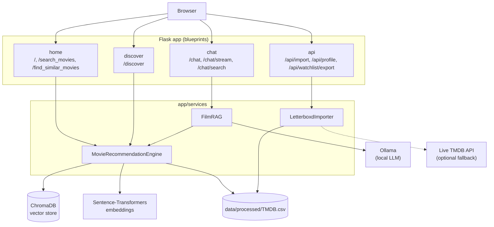
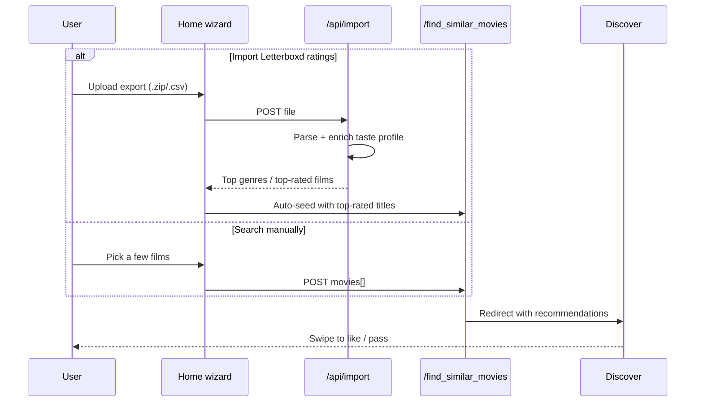

# 🎬 MovieScout - Movie Finder and Recommender

<a target="_blank" href="https://cookiecutter-data-science.drivendata.org/">
    
</a>
<a target="_blank" href="https://developer.mozilla.org/en-US/docs/Web/HTML">
    
</a>
<a target="_blank" href="https://www.w3.org/Style/CSS/">
    
</a>
<a target="_blank" href="https://developer.mozilla.org/en-US/docs/Web/JavaScript">
    
</a>
<a target="_blank" href="https://getbootstrap.com/">
    
</a>
<a target="_blank" href="https://flask.palletsprojects.com/">
    
</a>
<a target="_blank" href="https://www.themoviedb.org/documentation/api">
    
</a>
<a target="_blank" href="https://ollama.com">
    
</a>
<a target="_blank" href="https://github.com/MuhammetAliVarlik/MovieScout/actions/workflows/tests.yml">
    
</a>
<a target="_blank" href="LICENSE">
    
</a>

--
A web application that helps you find and explore movies based on your interests. By leveraging the TMDB dataset and semantic search, MovieScout lets you search for films, swipe through recommendations, import your Letterboxd ratings history, and chat with a local LLM for personalized suggestions.

---

## 🚀 Features

- **Search Movies**: Search for movies using the built-in TMDB dataset through an intuitive search input on the homepage.
- **Swipe to Discover**: A swipe interface to like/dislike movies and build up your favorites.
- **Semantic Search & Recommendations**: Find similar movies using a ChromaDB-backed embedding search.
- **Import your Letterboxd ratings**: Click "Import Letterboxd" in the navbar and upload a Letterboxd export `.zip` (or a bare `ratings.csv`) — MovieScout parses your ratings, enriches them against the local TMDB dataset, and excludes films you've already watched from future recommendations.
- **LLM Chat**: Ask a local LLM (via [Ollama](https://ollama.com)) for personalized recommendations, aware of your imported taste profile.
- **Responsive Design**: Optimized for both desktop and mobile viewing.

---

## 🧑‍💻 Technologies Used

### Frontend
HTML5, CSS3, JavaScript, Bootstrap 5.

### Backend
Flask, ChromaDB (semantic search), Sentence-Transformers (embeddings), Ollama (local LLM chat).

### Dataset
Fetched directly from [the TMDB API](https://www.themoviedb.org/documentation/api) — the top ~20,000 most popular movies by default, configurable. Nothing is bundled with the repo: TMDB's API terms don't allow redistributing their data, so `scripts/build_dataset.py` fetches your own local copy with your own free API key as part of setup, below. This is a deliberate scope choice, not a limitation — semantic recommendations work fine over a large, popularity-ranked subset, and a bounded fetch is fast and stays well within TMDB's rate limits.

---

## 🏗️ Architecture



The recommendation engine (semantic search over `data/processed/TMDB.csv` via ChromaDB + Sentence-Transformers) is instantiated once at startup and shared across blueprints. Chat's `FilmRAG` reuses the same engine for context, then calls a local Ollama model for the actual response — no data leaves your machine. See [`STRUCTURE.md`](STRUCTURE.md) for the full file layout.

**The "wizard" flow** — telling MovieScout what you like, either by searching or importing Letterboxd, both feed the same recommendation path:



---

## 📸 Media

### Homepage:


### Movie Details:


### Similar Movies:


### Movies Chat:


## 📦 Installation

To run the project locally:

1. **Clone the repository**:
   ```bash
   git clone https://github.com/MuhammetAliVarlik/MovieScout.git
   cd MovieScout
   ```
2. **Install dependencies** (Python 3.10+):
   ```bash
   pip install -r requirements.txt
   ```
3. **Configure environment variables**:
   ```bash
   cp .env.example .env
   ```
   Add a free TMDB API key ([themoviedb.org/settings/api](https://www.themoviedb.org/settings/api), no approval needed for non-commercial use) — `TMDB_API_KEY=...` in `.env`. Required for the next step; optional at runtime after that (only used as a Letterboxd-import enrichment fallback).
4. **Fetch the dataset and build the search index**:
   ```bash
   python scripts/setup.py
   ```
   Runs two explicit, progress-visible steps: fetching the top `TMDB_BUILD_LIMIT` (default 20,000) most popular movies from TMDB, then embedding them into a local ChromaDB index for semantic search. See the timing table below to set expectations — this only needs to be run once (or again later to refresh stale data).
5. **Run the app**:
   ```bash
   python run.py
   ```
   Visit `http://localhost:5000`.

   | N (movies) | Fetch (TMDB API) | Indexing (CPU) | Indexing (GPU) |
   |---|---|---|---|
   | 5,000 | ~2–3 min | ~1–2 min | seconds |
   | 20,000 (default) | ~8–12 min | ~3–5 min | ~1 min |
   | 50,000 | ~20–30 min | ~8–12 min | ~2–3 min |

   Rough estimates — actual time depends on your connection speed, CPU, and whether `sentence-transformers` has a GPU available.

### Optional: enable LLM chat

The `/chat` page needs a local LLM served by [Ollama](https://ollama.com). Every other feature works without it.

```bash
# Install Ollama from https://ollama.com, then:
ollama pull llama3.2:3b
```

Ollama typically starts its server automatically; if not, run `ollama serve`. Without it, `/chat` still loads and shows a clear inline message explaining what to do instead of failing.

### 🐳 Run with Docker

```bash
cp .env.example .env   # skip if you already created one above, add your TMDB_API_KEY
docker compose run --rm web python scripts/setup.py   # fetch + index, once
docker compose up --build
```

Visit `http://localhost:5000`. The first build installs everything from scratch (sentence-transformers, ChromaDB, etc.) so it can take several minutes, on top of the setup step's own fetch/indexing time (see the timing table above); later builds reuse Docker's layer cache and are fast. `docker-compose.yml` bind-mounts `./data` into the container, so the dataset and ChromaDB index persist across restarts — the setup step above only needs to run once. Ollama (for `/chat`) isn't containerized here — it's expected to run on the host, or point `OLLAMA_HOST` in `.env` at wherever it's reachable.

## ✅ Testing

```bash
pip install -r requirements.txt -r requirements-dev.txt
pytest
```

The same suite runs in CI on every push (`.github/workflows/tests.yml`) — route-level tests for home/search/discover/import/export, plus model and Letterboxd-import unit tests.

## 🔒 Security notes

This is a portfolio/demo project. There are no user accounts, and the only state-changing endpoints (search, recommendations, Letterboxd import) are same-origin form/file submissions with no destructive cross-site action, so CSRF/CORS middleware was intentionally left out to keep the app simple. Treat it accordingly if you extend it toward a multi-user deployment.

## 🎞️ TMDB compliance

This product uses the TMDB API but is not endorsed or certified by TMDB (notice also shown in the app's footer, as required by [TMDB's attribution terms](https://www.themoviedb.org/about/logos-attribution)). No TMDB data is bundled with or redistributed by this repository — `scripts/build_dataset.py` fetches a bounded subset locally with your own API key, and `data/.fetch_meta.json` tracks when it was fetched so the app can warn you before you hit TMDB's 6-month cache limit.

## 🧾 Notebooks

`notebooks/` holds the original data-exploration and prototyping work (preprocessing the raw Kaggle dataset, early semantic-search and LLM-search experiments) that predates the Flask app — kept for history, not required to run the app itself.

## 🤝 Contributing

Contributions are welcome! Feel free to open issues or submit pull requests to improve this project.

Enjoy exploring movies with MovieScout! 🍿
