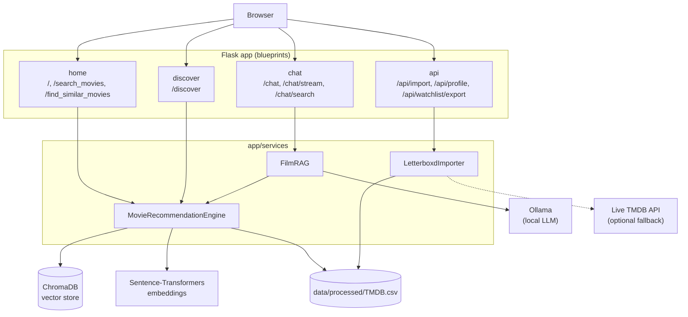
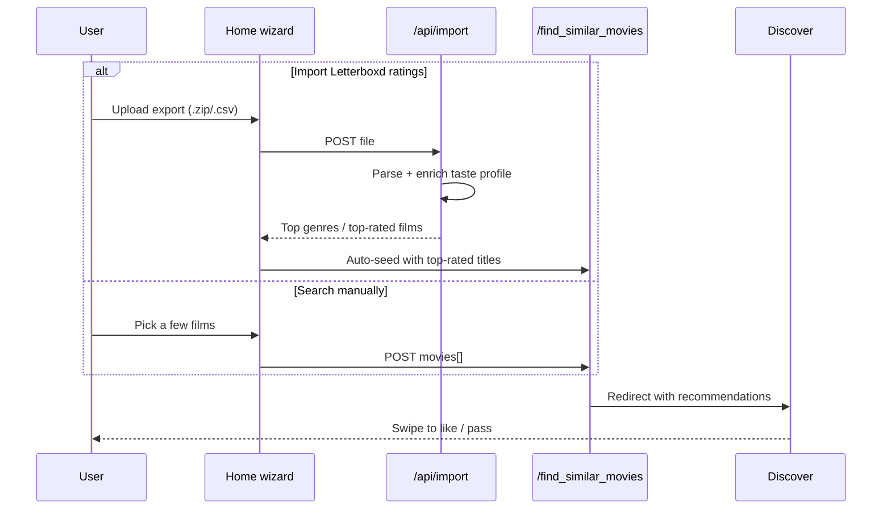

# 🎬 MovieScout - Movie Finder and Recommender

<a target="_blank" href="https://cookiecutter-data-science.drivendata.org/">
    
</a>
<a target="_blank" href="https://developer.mozilla.org/en-US/docs/Web/HTML">
    
</a>
<a target="_blank" href="https://www.w3.org/Style/CSS/">
    
</a>
<a target="_blank" href="https://developer.mozilla.org/en-US/docs/Web/JavaScript">
    
</a>
<a target="_blank" href="https://getbootstrap.com/">
    
</a>
<a target="_blank" href="https://flask.palletsprojects.com/">
    
</a>
<a target="_blank" href="https://www.themoviedb.org/documentation/api">
    
</a>
<a target="_blank" href="https://ollama.com">
    
</a>
<a target="_blank" href="https://github.com/MuhammetAliVarlik/MovieScout/actions/workflows/tests.yml">
    
</a>
<a target="_blank" href="LICENSE">
    
</a>

--
A web application that helps you find and explore movies based on your interests. By leveraging the TMDB dataset and semantic search, MovieScout lets you search for films, swipe through recommendations, import your Letterboxd ratings history, and chat with a local LLM for personalized suggestions.

---

## 🚀 Features

- **Search Movies**: Search for movies using the built-in TMDB dataset through an intuitive search input on the homepage.
- **Swipe to Discover**: A swipe interface to like/dislike movies and build up your favorites.
- **Semantic Search & Recommendations**: Find similar movies using a ChromaDB-backed embedding search.
- **Import your Letterboxd ratings**: Click "Import Letterboxd" in the navbar, then either upload a Letterboxd export `.zip` (or a bare `ratings.csv`), or — if your profile is public — just type your username to pull recently watched, rated films straight from your [Letterboxd diary RSS feed](https://letterboxd.com/about/rss-feeds/) (`letterboxd.com/<username>/rss/`), no export/upload needed. Either way, MovieScout enriches the result against the local TMDB dataset and excludes films you've already watched from future recommendations. The RSS route only covers recent activity, not your full history — use the file export for that.
- **LLM Chat**: Ask a local LLM (via [Ollama](https://ollama.com)) for personalized recommendations, aware of your imported taste profile.
- **Responsive Design**: Optimized for both desktop and mobile viewing.

---

## 🧑‍💻 Technologies Used

### Frontend
HTML5, CSS3, JavaScript, Bootstrap 5.

### Backend
Flask, ChromaDB (semantic search), Sentence-Transformers (embeddings), Ollama (local LLM chat).

### Dataset
Fetched directly from [the TMDB API](https://www.themoviedb.org/documentation/api) — the top ~10,000 most popular movies by default (TMDB's own `/discover` pagination hard-caps at 10,000 results for any single sort order, so that's the practical ceiling regardless of `TMDB_BUILD_LIMIT`). Nothing is bundled with the repo: TMDB's API terms don't allow redistributing their data, so `scripts/build_dataset.py` fetches your own local copy with your own free API key as part of setup, below. This is a deliberate scope choice, not a limitation — semantic recommendations work fine over a large, popularity-ranked subset, and a bounded fetch is fast and stays well within TMDB's rate limits.

---

## 🏗️ Architecture



The recommendation engine (semantic search over `data/processed/TMDB.csv` via ChromaDB + Sentence-Transformers) is instantiated once at startup and shared across blueprints. Chat's `FilmRAG` reuses the same engine for context, then calls a local Ollama model for the actual response — no data leaves your machine. See [`STRUCTURE.md`](STRUCTURE.md) for the full file layout.

**The "wizard" flow** — telling MovieScout what you like, either by searching or importing Letterboxd, both feed the same recommendation path:



---

## 🧠 How recommendations work

Everything below lives in `app/services/recommendation.py` (`MovieRecommendationEngine`).

**1. Indexing (`scripts/build_index.py`, once per dataset refresh).**
For every movie, `title + " " + overview + " " + genres` is combined into one string and embedded with [`all-MiniLM-L6-v2`](https://huggingface.co/sentence-transformers/all-MiniLM-L6-v2) (a 384-dimension Sentence-Transformers model) into ChromaDB, using cosine similarity as the distance metric. No poster, cast, runtime, or rating data feeds the embedding — those are stored alongside for display and filtering, but don't affect *which* movies are considered similar.

**2. Building a query from your picks (`get_recommendations`).**
You can seed recommendations with more than one movie — either by picking a few on the Home page, or automatically from the top 5 highest-rated films in an imported Letterboxd profile. Each selected movie's `title + overview + genres` text is embedded **individually**, and the resulting vectors are **averaged** into a single query vector.

That's deliberate, not incidental: `all-MiniLM-L6-v2` has a 256-token limit. Concatenating several movies' title+overview+genres into *one* string and embedding that (the original approach) silently exceeds that limit once more than ~2 movies are selected — the tokenizer truncates, and whichever picks come last in the string never actually influence the result. Embedding each movie separately and averaging sidesteps the limit entirely and treats every pick equally, regardless of how many you select.

**3. Search + filtering.**
The averaged vector is queried against ChromaDB for nearest neighbors (`limit × 3` candidates normally, `limit × 10` when a genre or minimum-rating filter is active, since filtering happens *after* retrieval and can eliminate a lot of the pool). From that candidate pool:
- Movies you already selected, or already have in your imported taste profile, are excluded.
- An optional **genre** filter keeps only movies whose genre list contains the chosen genre (substring match).
- An optional **minimum rating** filter drops anything below the chosen TMDB vote average.
- Results are deduplicated by title and capped at `limit` (`MAX_RECOMMENDATIONS` in `.env`, default 20).

Each result carries a `similarity_score` = `1 − cosine_distance` from ChromaDB, shown in the UI as a rough "how close is this to your picks" signal — closer to 1 is a stronger match.

**4. Caching.** The full computation (embedding + ANN search + filtering) is cached for 10 minutes, keyed by the exact combination of selected titles, excluded titles, limit, genre, and minimum rating — re-requesting the same picks doesn't redo the embedding or search.

**5. Chat reuses the same index.** `/chat` doesn't run its own search — `FilmRAG` embeds your message text and queries the same ChromaDB collection for `RAG_CONTEXT_FILMS` (default 10) relevant movies, which get folded into the system prompt sent to the local Ollama model.

---

## 📸 Media

### Homepage — search or import your taste:


### Discover — swipe to like/pass:


### Movie Details:


### Import your Letterboxd — file upload or just a username:


### Your watchlist — review, export, or share:


### Film Assistant — chat with a local LLM:


<video src="docs/demo/movie_assistant.mp4?raw=true" controls width="100%">Film Assistant demo — your browser doesn't support inline video; see docs/demo/movie_assistant.mp4</video>

## 📦 Installation

To run the project locally:

1. **Clone the repository**:
   ```bash
   git clone https://github.com/MuhammetAliVarlik/MovieScout.git
   cd MovieScout
   ```
2. **Install dependencies** (Python 3.10+):
   ```bash
   pip install -r requirements.txt
   ```
3. **Configure environment variables**:
   ```bash
   cp .env.example .env
   ```
   Add a free TMDB API key ([themoviedb.org/settings/api](https://www.themoviedb.org/settings/api), no approval needed for non-commercial use) — `TMDB_API_KEY=...` in `.env`. Required for the next step; optional at runtime after that (only used as a Letterboxd-import enrichment fallback).
4. **Fetch the dataset and build the search index**:
   ```bash
   python scripts/setup.py
   ```
   Runs two explicit, progress-visible steps: fetching the top `TMDB_BUILD_LIMIT` (default 10,000 — also TMDB's own hard ceiling for `/discover/movie` pagination, regardless of this setting) most popular movies from TMDB, then embedding them into a local ChromaDB index for semantic search. See the timing table below to set expectations — this only needs to be run once (or again later to refresh stale data).
5. **Run the app**:
   ```bash
   python run.py
   ```
   Visit `http://localhost:5000`.

   | N (movies) | Fetch (TMDB API) | Indexing (CPU) | Indexing (GPU) |
   |---|---|---|---|
   | 5,000 | ~30s–1 min | ~2 min | seconds |
   | 10,000 (default, TMDB's max) | ~1 min | ~4 min | ~1 min |

   Measured end-to-end on a real run (CPU-only, ~10,000 movies): fetch 55s, indexing 4 min. Actual time depends on your connection speed, CPU, and whether `sentence-transformers` has a GPU available.

### Optional: enable LLM chat

The `/chat` page needs a local LLM served by [Ollama](https://ollama.com). Every other feature works without it.

```bash
# Install Ollama from https://ollama.com, then:
ollama pull llama3.2:3b
```

Ollama typically starts its server automatically; if not, run `ollama serve`. Without it, `/chat` still loads and shows a clear inline message explaining what to do instead of failing.

### 🐳 Run with Docker

```bash
cp .env.example .env   # skip if you already created one above, add your TMDB_API_KEY
docker compose run --rm web python scripts/setup.py   # fetch + index, once
docker compose up --build
```

Visit `http://localhost:5000`. The first build installs everything from scratch (sentence-transformers, ChromaDB, etc.) so it can take several minutes, on top of the setup step's own fetch/indexing time (see the timing table above); later builds reuse Docker's layer cache and are fast. `docker-compose.yml` bind-mounts `./data` into the container, so the dataset and ChromaDB index persist across restarts — the setup step above only needs to run once. Ollama (for `/chat`) isn't containerized here — it's expected to run on the host, or point `OLLAMA_HOST` in `.env` at wherever it's reachable.

## ✅ Testing

```bash
pip install -r requirements.txt -r requirements-dev.txt
pytest
```

The same suite runs in CI on every push (`.github/workflows/tests.yml`) — route-level tests for home/search/discover/import/export, plus model and Letterboxd-import unit tests.

## 🔒 Security notes

This is a portfolio/demo project. There are no user accounts, and the only state-changing endpoints (search, recommendations, Letterboxd import) are same-origin form/file submissions with no destructive cross-site action, so CSRF/CORS middleware was intentionally left out to keep the app simple. Treat it accordingly if you extend it toward a multi-user deployment.

What's already in place:
- **Debug mode is off by default.** `FLASK_ENV` defaults to `production` in code — `.env.example` sets `development` for local convenience, but since `run.py` binds `host="0.0.0.0"` (required for Docker's port mapping), leaving debug mode on anywhere network-reachable would expose Werkzeug's interactive, code-executing debugger. The app prints a warning at startup if debug mode is on, and another if `SECRET_KEY` is still the placeholder default (Flask signs session cookies with it — a shared key lets anyone forge a session).
- **Upload limits.** `MAX_CONTENT_LENGTH` caps any request body at 25MB, and the Letterboxd ZIP importer separately checks the archive's claimed decompressed size before reading it, so a malicious "zip bomb" export can't balloon memory.
- **The Letterboxd RSS import** (see Features above) only ever fetches `https://letterboxd.com/<validated-username>/rss/` — the username is checked against Letterboxd's actual character set before it touches a URL, so there's no way to redirect the request elsewhere. The feed is parsed with `defusedxml`, not the stdlib XML parser, as defense-in-depth against malicious/oversized XML.
- **Docker runs as a non-root user** (Dockerfile), not root, as a baseline container hardening measure.

What isn't: no rate limiting, no auth, no HTTPS termination (put a reverse proxy in front of it if you deploy this beyond your own machine).

## 🎞️ TMDB compliance

This product uses the TMDB API but is not endorsed or certified by TMDB (notice also shown in the app's footer, as required by [TMDB's attribution terms](https://www.themoviedb.org/about/logos-attribution)). No TMDB data is bundled with or redistributed by this repository — `scripts/build_dataset.py` fetches a bounded subset locally with your own API key, and `data/.fetch_meta.json` tracks when it was fetched so the app can warn you before you hit TMDB's 6-month cache limit.

## 🧾 Notebooks

`notebooks/` holds the original data-exploration and prototyping work (preprocessing the raw Kaggle dataset, early semantic-search and LLM-search experiments) that predates the Flask app — kept for history, not required to run the app itself.

## 🤝 Contributing

Contributions are welcome! Feel free to open issues or submit pull requests to improve this project.

Enjoy exploring movies with MovieScout! 🍿
